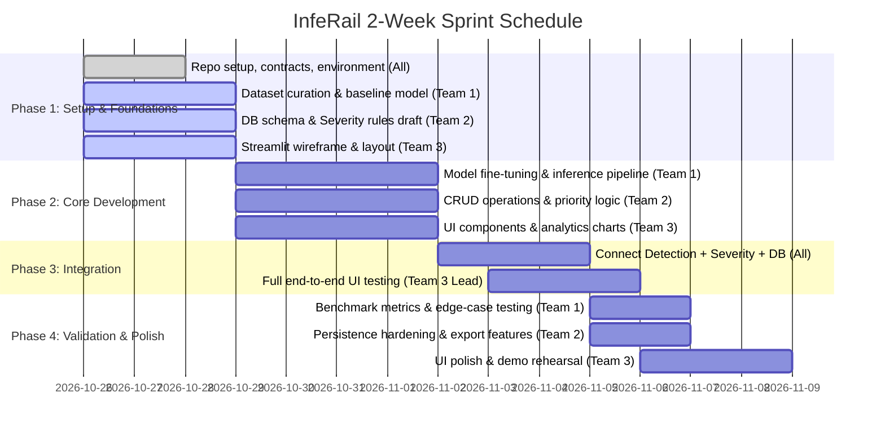

# InfeRail — Railway Track Health Intelligence System

[](https://www.python.org/)
[](https://streamlit.io/)
[](https://ultralytics.com/)
[](https://www.sqlite.org/)

---

## 1. Project Explanation & Overview

### 1.1 Problem Statement
Railway tracks are subject to heavy continuous dynamic mechanical loads, temperature variations, and environmental stress. Over time, these conditions cause various surface and structural track defects, such as:
- **Surface Cracks / Fractures** on the rail head
- **Missing or Broken Fasteners / Clips / Tie Plates**
- **Ballast Degradation & Voiding**
- **Fishplate / Joint Failures**
- **Squats, Spalling, and Shelling**

Traditional track inspection relies heavily on manual foot patrols and periodic specialized inspection cars. Manual inspection is slow, hazardous to personnel, qualitative, prone to human fatigue, and hard to audit at scale.

### 1.2 Proposed Solution: InfeRail
**InfeRail** is an intelligent, automated inspection prototype that uses computer vision and automated prioritization to detect railway track defects from uploaded track imagery (and video frames), estimate defect severity, persist inspection records to an auditable database, and visualize health trends on a maintenance dashboard.

### 1.3 Core Workflow
```mermaid
flowchart LR
    A[Track Image Upload] --> B[Image Preprocessing & Validation\n(Team 1)]
    B --> C[AI Defect Detection Model\n(Team 1)]
    C --> D[Severity & Priority Rules\n(Team 2)]
    D --> E[Inspection Database Persistence\n(Team 2)]
    E --> F[Interactive Web Dashboard\n(Team 3)]
    F --> G[Alerts & PDF/CSV Export\n(Team 3)]
```

1. **Ingestion & Preprocessing:** User uploads high-resolution track images (or video frame captures). The image is validated, normalized, and preprocessed.
2. **Defect Detection (AI Pipeline):** A trained computer-vision model (YOLOv8 / YOLOv11) inspects the frame to detect defect instances, providing bounding boxes, class labels, and confidence metrics.
3. **Severity & Priority Classification:** A rule-based domain engine converts raw detection metrics into actionable maintenance priority ratings (`Low`, `Medium`, `High`, `Critical`) with plain-language diagnostic rationales.
4. **Data Persistence:** The complete inspection event (timestamp, image path, detected defects, bounding boxes, priority ratings, and reasonings) is stored in a queryable SQLite database.
5. **Dashboard & Maintenance Insights:** Maintenance teams view annotated inspection images, filter past inspections, examine track health distribution, and export inspection logs.

> **Safety Notice:** InfeRail is an academic and operational prototype designed for decision-support and assistive screening. It is not certified for autonomous track certification without human oversight.

---

## 2. Recommended Tech Stack

| Layer | Recommended Technology | Why This Tech Stack Was Chosen |
|---|---|---|
| **Programming Language** | **Python 3.10+ / 3.11** | Industry standard for AI, Computer Vision, and rapid prototype engineering. High ecosystem compatibility. |
| **Object Detection & CV** | **Ultralytics YOLOv8 / YOLOv11** | State-of-the-art balance of high inference speed (real-time capable), strong accuracy on small defects, native support for bounding box annotations, and easy custom fine-tuning. |
| **Image Preprocessing** | **OpenCV (`opencv-python`) & Pillow** | Fast image loading, resizing, normalization, contrast enhancement (CLAHE for varying track lighting), and bounding box drawing. |
| **Data Augmentation & Metrics** | **Albumentations & Scikit-learn** | Synthetic augmentation (blur, glare, shadow, angle tilt) to build a robust model; standard evaluation metrics (Precision, Recall, mAP@50-95, F1-score). |
| **Database & Persistence** | **SQLite + SQLAlchemy / sqlite3** | Zero-configuration, serverless, self-contained, file-based SQL database ideal for rapid 2-week prototyping, seamless Git setup, and instant reproducibility. |
| **Data Schema Validation** | **Pydantic (v2)** | Guarantees strict data contracts between the AI pipeline, database, and UI layers, avoiding runtime interface bugs. |
| **Frontend & Visualization** | **Streamlit** | Rapid development of modern, responsive data dashboards in pure Python. Provides native file uploaders, image rendering, interactive data tables, and metrics widgets without complex frontend build tools. |
| **Analytics & Plotting** | **Plotly / Altair** | Interactive charts for defect distribution by category, timeline trends, and severity heatmaps. |
| **Testing & Quality Assurance** | **Pytest** | Automated unit tests for detection format, priority rules, database CRUD operations, and end-to-end integration. |
| **Environment & Git Management** | **venv / uv + GitHub** | Clean virtual environment isolation and git-based branch workflows. |

---

## 3. Team Structure & Work Division (3 Teams of 2 Members)

The project workload is structured into **3 specialized two-person teams**. Each team owns a core pillar of the architecture with clear interfaces and deliverables:

```
┌────────────────────────────────────────────────────────────────────────┐
│                        InfeRail Project Team                           │
├────────────────────┬────────────────────┬──────────────────────────────┤
│       Team 1       │       Team 2       │            Team 3            │
│ Computer Vision &  │ Data Persistence & │   Web Dashboard, System      │
│   AI Pipeline      │ Prioritization     │    Integration & QA          │
│ (Members 1 & 2)    │ (Members 3 & 4)    │      (Members 5 & 6)         │
└────────────────────┴────────────────────┴──────────────────────────────┘
```

---

### Team 1: Computer Vision & AI Pipeline
**Members:** Member 1 (AI Lead) & Member 2 (Data & Evaluation Engineer)  
**Primary Focus:** Model training/inference, dataset curation, image preprocessing, and performance benchmarking.

#### Member 1 — AI Model Lead & Inference Engine
- **Core Tasks:**
  - Select and set up the detection architecture (e.g., YOLOv8n / YOLOv8s for speed and reliability).
  - Train or fine-tune the model on railway track defect categories (cracks, missing fasteners, defective joints, spalling).
  - Develop `detection/detector.py`: clean inference function taking an image (or path) and outputting standardized detections (bounding boxes, class names, confidence scores).
  - Implement visualization helper to render professional bounding boxes with color-coded classes on output images.
  - Document model weights, inference latency, and hardware prerequisites.
- **Deliverables:**
  - `detection/detector.py`
  - Model weights file (e.g., `models/best.pt`) and download/export script
  - Annotated output image generator
  - Inference unit test script

#### Member 2 — Dataset Curation, Preprocessing & Evaluation
- **Core Tasks:**
  - Source and curate track defect datasets (e.g., RSDDs, Rail Surface Defect Database, NEU surface defects, or open Roboflow railway datasets).
  - Validate image annotations (YOLO format), split into clean train/val/test partitions (e.g., 70/15/15).
  - Implement preprocessing and augmentation in `detection/preprocessing.py` (contrast adjustment, CLAHE for outdoor track shadows/glare, resizing).
  - Formulate a test set of challenging real-world edge cases (clean track, rust, shadow vs. real crack, nighttime/low-light).
  - Compute model metrics: mAP@50, mAP@50-95, Precision, Recall, and Confusion Matrix.
- **Deliverables:**
  - `dataset/README.md` (data dictionary, sources, license, and download links)
  - Curated test set directory (`dataset/sample_test_images/`)
  - Evaluation report summarizing accuracy and failure modes (false positives & false negatives)
  - Preprocessing pipeline modules

**Team 1 Handoff Contract:** Team 1 provides `detect_defects(image_input) -> Tuple[List[DetectionResult], np.ndarray]` to Teams 2 and 3.

---

### Team 2: Data Persistence & Prioritization Engine
**Members:** Member 3 (Backend & Database Engineer) & Member 4 (Domain Logic & Severity Specialist)  
**Primary Focus:** Relational data storage, historical inspection queries, rule-based maintenance severity assessment, and data integrity.

#### Member 3 — Database Architecture & CRUD Service
- **Core Tasks:**
  - Design normalized SQLite schema in `database/db.py` handling two primary tables:
    1. `inspections`: session metadata (ID, timestamp, image name, overall severity, inspector notes).
    2. `defects`: detected instances (defect ID, inspection ID foreign key, defect type, confidence, bounding box coordinates, assigned priority).
  - Implement database helper methods: `init_db()`, `save_inspection_record()`, `get_all_inspections()`, `get_inspection_details(id)`, and `filter_inspections_by_severity()`.
  - Ensure safe database transactions, handle missing values, and test database persistence across app restarts.
  - Provide seed data script (`database/seed_data.py`) for offline dashboard testing.
- **Deliverables:**
  - `database/schema.sql` and `database/db.py`
  - Database unit tests verifying save and query operations
  - Seed script with mock historical inspections

#### Member 4 — Severity Rules & Maintenance Prioritization Engine
- **Core Tasks:**
  - Design transparent, deterministic domain rules for railway maintenance in `prioritization/severity.py`.
  - Categorize priority into four tiers:
    - **CRITICAL:** Immediate derailment risk (e.g., broken rail, missing multiple consecutive fasteners).
    - **HIGH:** Significant track defect requiring rapid maintenance (e.g., wide surface crack, broken fishplate).
    - **MEDIUM:** Developing defect requiring scheduled inspection (e.g., minor spalling, light surface wear).
    - **LOW / MONITOR:** Cosmetic surface flaw or superficial rust.
  - Formulate multi-defect rollup logic: if an image contains both a minor crack and a missing fastener, determine the overall inspection priority.
  - Generate clear, human-readable explanations (e.g., *"Assigned HIGH: Defect type 'Broken Fastener' exceeds threshold of single-point retention tolerance"*).
  - Explicitly document that confidence score is not severity (a high-confidence minor scratch is still Low severity).
- **Deliverables:**
  - `prioritization/severity.py`
  - Priority rule decision table and logic documentation
  - Comprehensive unit tests covering various combinations of defect types and counts

**Team 2 Handoff Contract:** Team 2 provides `evaluate_priority(detections) -> PriorityReport` and `save_inspection(record) -> int` to Team 3.

---

### Team 3: Web Dashboard, System Integration & QA
**Members:** Member 5 (UI/UX & Dashboard Engineer) & Member 6 (System Integration & QA Lead)  
**Primary Focus:** Interactive user interface, end-to-end integration, error handling, automated testing, and release coordination.

#### Member 5 — Interactive Web Dashboard & Visualization
- **Core Tasks:**
  - Build modern, intuitive multi-page or tabbed UI in `app.py` using Streamlit:
    - **Tab 1: Live Track Inspection:** File uploader (JPG/PNG), "Run Inspection" action, side-by-side original vs. annotated image, summary cards for detected defects and overall priority badge.
    - **Tab 2: Inspection History & Audit Log:** Searchable, sortable table of past inspections, filter by date range, defect category, or priority level, with clickable records.
    - **Tab 3: Track Health Analytics:** Aggregated visual charts (Plotly) showing defect distributions, monthly severity trends, and top recurring defect locations.
    - **Tab 4: Export & Reporting:** Download inspection reports as CSV or formatted PDF summary.
  - Implement responsive loading states, error banners, and empty-state messages ("No defects detected by the model; track segment is visually clear").
- **Deliverables:**
  - `app.py` and `dashboard/components.py`
  - Interactive charts and inspection detail view
  - Export utilities (CSV / PDF)

#### Member 6 — System Integration, QA & Project Lead
- **Core Tasks:**
  - Establish GitHub repository standards: branching strategy (`feature/*`), `.gitignore`, and `requirements.txt`.
  - Maintain the unified pipeline glue code connecting Team 1 (Detection), Team 2 (Severity + DB), and Team 3 (Dashboard).
  - Write end-to-end integration tests (`tests/test_integration.py`) validating the pipeline from dummy image input to database record retrieval.
  - Implement graceful exception handling for corrupted images, missing model weights, and database locks.
  - Lead daily 15-minute standups, monitor blockers, enforce timeline milestones, and prepare demo rehearsal.
- **Deliverables:**
  - Repository configuration, `requirements.txt`, and setup documentation
  - `tests/test_integration.py` test suite
  - Live demo plan, sample test assets, and backup slide deck/recording

**Team 3 Handoff Contract:** Delivers the packaged, runnable application with documentation and verified end-to-end stability.

---

## 4. Shared Data Contract

To allow all three teams to work independently without merge blockers, the data contract between modules is defined using Python dictionaries / Pydantic models:

### 4.1 Defect Detection Result (Team 1 Output -> Teams 2 & 3 Input)
```python
{
    "defect_id": 1,
    "class_name": "crack",               # "crack", "missing_fastener", "broken_rail", "joint_defect"
    "confidence": 0.89,                   # float between 0.0 and 1.0
    "bbox": [120, 245, 380, 410],        # [x_min, y_min, x_max, y_max] normalized or pixel coords
    "area_pixels": 42900                 # estimated area (optional)
}
```

### 4.2 Priority Evaluation Result (Team 2 Output -> Teams 2 & 3 Input)
```python
{
    "overall_priority": "HIGH",           # "LOW", "MEDIUM", "HIGH", "CRITICAL"
    "defect_priorities": [
        {
            "class_name": "crack",
            "priority": "HIGH",
            "reason": "Surface fracture length exceeds standard tolerance threshold"
        }
    ],
    "action_recommendation": "Dispatch maintenance crew for ultrasound inspection within 24 hours."
}
```

### 4.3 Full Inspection Database Record (Saved by Team 2, Displayed by Team 3)
```python
{
    "inspection_id": "INSP-20261025-001",
    "timestamp": "2026-10-25 14:30:00",
    "image_name": "track_milemarker_42_km12.jpg",
    "image_path": "uploads/track_milemarker_42_km12.jpg",
    "annotated_image_path": "outputs/annotated_track_milemarker_42_km12.jpg",
    "total_defects_found": 1,
    "overall_priority": "HIGH",
    "recommendation": "Dispatch maintenance crew for ultrasound inspection within 24 hours.",
    "defects": [
        {
            "class_name": "crack",
            "confidence": 0.89,
            "bbox": [120, 245, 380, 410],
            "priority": "HIGH"
        }
    ]
}
```

---

## 5. Suggested Project Directory Structure

```text
InfeRail/
├── app.py                          # Main Streamlit Application (Team 3)
├── requirements.txt                # Unified Python Dependencies (Team 3)
├── README.md                       # Project Guide & Documentation (All)
├── .gitignore                      # Git Ignore Configurations (Team 3)
├── config.py                       # Global Path & Threshold Settings (All)
│
├── detection/                      # Owned by Team 1
│   ├── __init__.py
│   ├── detector.py                 # Inference wrapper for YOLOv8/YOLOv11
│   ├── preprocessing.py          # CLAHE, resizing, normalization
│   └── visualizer.py               # Bounding box rendering utilities
│
├── dataset/                        # Owned by Team 1
│   ├── README.md                   # Dataset documentation & download links
│   ├── sample_test_images/         # Curated test images for demo & testing
│   └── evaluate.py                 # Evaluation metrics script (mAP, F1)
│
├── prioritization/                 # Owned by Team 2
│   ├── __init__.py
│   ├── severity.py                 # Rule-based priority assignment engine
│   └── rules_config.json           # Configurable priority thresholds & logic
│
├── database/                       # Owned by Team 2
│   ├── __init__.py
│   ├── schema.sql                  # SQLite DDL scripts
│   ├── db.py                       # Database connection and CRUD functions
│   └── seed_data.py                # Synthetic history generator for testing
│
├── dashboard/                      # Owned by Team 3
│   ├── __init__.py
│   ├── components.py               # UI widgets, layout containers, cards
│   ├── charts.py                   # Plotly charts for analytics
│   └── export.py                   # CSV / PDF export utilities
│
├── tests/                          # Owned by Team 3 with inputs from all
│   ├── test_detection.py           # Team 1 tests
│   ├── test_prioritization.py      # Team 2 tests
│   ├── test_database.py            # Team 2 tests
│   └── test_integration.py         # End-to-end integration tests (Team 3)
│
├── models/                         # Model weights directory (gitignored)
│   └── best.pt
│
├── uploads/                        # User-uploaded images (gitignored)
└── outputs/                        # Saved annotated images (gitignored)
```

---

## 6. Two-Week Execution Plan



### Detailed Schedule by Day:

- **Days 1–2 (Sprint Kickoff & Setup):**
  - **All:** Align on shared data contracts and Python 3.10/3.11 environment.
  - **Team 1:** Download sample dataset and run baseline YOLO detection.
  - **Team 2:** Initialize SQLite database with DDL tables; document priority rules.
  - **Team 3:** Set up Git repo, initialize Streamlit app with file uploader dummy layout.
  - *Milestone:* All 3 teams have working initial scaffolding on independent branches.

- **Days 3–5 (Component Development):**
  - **Team 1:** Package `detect_defects()` to return standard JSON detections + annotated image; prepare evaluation script.
  - **Team 2:** Complete `save_inspection()` and `get_history()` in `db.py`; code `assign_priority()` rules in `severity.py`.
  - **Team 3:** Build detection viewer, history table widget, and basic metrics charts using mock data.
  - *Milestone:* Each team completes standalone unit tests for their respective module.

- **Days 6–8 (First Integrated Prototype):**
  - **Integration Session:** Team 3 links Team 1's detector and Team 2's severity + database into `app.py`.
  - Verify complete loop: Upload image -> Run YOLO -> Compute severity -> Save to SQLite -> Render on UI -> View in History table.
  - *Milestone:* First end-to-end prototype functioning on a developer machine.

- **Days 9–11 (Robustness, Testing & Error Handling):**
  - **Team 1:** Benchmark accuracy metrics on unseen test images; record confusion matrix and failure cases.
  - **Team 2:** Add database indexing, history filtering queries (by defect type, date, severity), and verify database persistence.
  - **Team 3:** Graceful handling of edge cases: blank images, unreadable formats, zero detections ("Track clear"), and model timeouts. Add CSV/PDF export.
  - *Milestone:* System passes full test suite without breaking on corrupt or empty inputs.

- **Days 12–14 (Code Freeze, Documentation & Demo Prep):**
  - Strict feature freeze: only bug fixes permitted.
  - Prepare high-confidence demo dataset and backup video recording/screenshots.
  - Finalize README, installation guide, and presentation slide deck.
  - Rehearse the live walkthrough end-to-end.
  - *Milestone:* Project successfully presented and delivered.

---

## 7. Testing & Quality Assurance Checklist

### Team 1 Checklist (Vision & AI)
- [ ] Model weights download cleanly and load into memory without path errors.
- [ ] Bounding boxes, labels, and confidence scores match the shared data contract.
- [ ] Images with no defects return an empty detection list (do not crash).
- [ ] Inference time is logged and runs in < 1.5 seconds per standard image on CPU/GPU.
- [ ] Evaluation metrics (mAP@50, Precision, Recall) are documented on the test set.

### Team 2 Checklist (Database & Prioritization)
- [ ] Priority rules cover all supported defect classes without throwing unhandled exceptions.
- [ ] Confidence score is not conflated with severity.
- [ ] Database persists data across complete application restarts.
- [ ] Inspection records and associated defect records maintain correct foreign key relationships.
- [ ] SQL queries handle special characters and missing fields safely.

### Team 3 Checklist (Dashboard & Integration)
- [ ] Streamlit web UI starts cleanly with a single command (`streamlit run app.py`).
- [ ] Uploading PNG, JPG, and JPEG formats works seamlessly.
- [ ] Original and annotated images display side-by-side with clear defect legends.
- [ ] History table correctly filters by defect type and priority level.
- [ ] Export buttons generate valid CSV or PDF summaries.

---

## 8. Definition of Done (DoD)

The InfeRail project is considered **Done and Demo-Ready** when:
1. **End-to-End Execution:** A user can launch the app, upload an arbitrary railway track image, observe real-time defect annotations, review the rule-based maintenance recommendation, and verify the record is saved to the history log.
2. **Defect Coverage:** The system reliably detects key target defects (e.g., surface cracks, missing fasteners).
3. **Data Integrity:** Historical records survive application restarts with intact timestamps, bounding box metadata, and priority reasons.
4. **Clean Code & Reproducibility:** Anyone can clone the repository, install dependencies via `pip install -r requirements.txt`, and launch the app without manual file editing.
5. **Academic Honesty:** Limitations, false-positive vulnerabilities, and railway safety boundaries are clearly documented.
