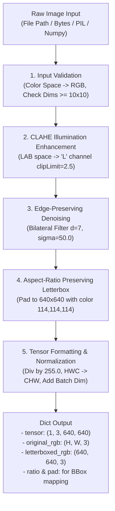

# InfeRail — Image Preprocessing Specification & Parameter Guide

> **Module Owner:** Team 1 (AI & Computer Vision Pipeline Lead)  
> **Target Module:** [`detection/preprocessing.py`](file:///c:/Users/Aniket/OneDrive/Desktop/InfeRail/detection/preprocessing.py)  
> **Config Files:** [`parameters.yaml`](file:///c:/Users/Aniket/OneDrive/Desktop/InfeRail/Inferail/docs/preprocessing/parameters.yaml) | [`parameters.json`](file:///c:/Users/Aniket/OneDrive/Desktop/InfeRail/Inferail/docs/preprocessing/parameters.json)

---

## 1. Folder & File Structure

The preprocessing system is structured to cleanly decouple raw data ingestion, parameter configuration, image transformations, and automated testing:

```text
InfeRail/
├── detection/
│   ├── __init__.py                  # Exposes preprocessing functions to Team 1 & Team 3
│   ├── preprocessing.py             # Core pipeline (Validation, CLAHE, Denoising, Letterboxing)
│   └── detector.py                  # YOLO model inference wrapper (consumes preprocessed tensor)
│
├── docs/
│   └── preprocessing/
│       ├── README.md                # This comprehensive specification guide
│       ├── parameters.yaml          # YAML configuration of all hyperparameters
│       └── parameters.json          # JSON configuration for direct dictionary loading
│
├── dataset/
│   ├── sample_test_images/          # Curated test images (cracks, clean track, shadow cases)
│   ├── generate_sample_images.py    # Synthetic track generator for offline testing
│   └── README.md                    # Dataset sources, splits & annotation formats
│
├── tests/
│   └── test_preprocessing.py        # Automated pytest suite testing every transform & edge-case
│
├── venv/                            # Isolated virtual environment (Git-ignored)
└── requirements.txt                 # Pinned dependencies (OpenCV, PyTorch, Ultralytics, Albumentations)
```

---

## 2. End-to-End Pipeline Architecture



---

## 3. Comprehensive Parameter Reference

### Stage 1: Input Validation & Sanitization

| Parameter | Type | Default Value | Valid Range | Physical Railway Significance & Description |
|---|---|---|---|---|
| `supported_extensions` | `List[str]` | `['.jpg', '.jpeg', '.png', '.bmp', '.tif']` | Any image MIME type | Restricts uploads on the Streamlit dashboard to valid camera formats from patrol drones or track inspection cars. |
| `min_height`, `min_width` | `int` | `10`, `10` | $\ge 10$ pixels | Rejects corrupted or truncated image files before allocating memory. |
| `target_color_space` | `str` | `"RGB"` | `"RGB"` | OpenCV reads images in **BGR** order by default. Converting to **RGB** is mandatory because PyTorch, Ultralytics, and Streamlit display widgets expect RGB channels. |
| `enforce_uint8` | `bool` | `True` | `True / False` | Ensures pixel intensities are within integer range `[0, 255]`. Scales `[0.0, 1.0]` floats automatically if detected. |

---

### Stage 2: Illumination & Contrast Enhancement (CLAHE)

*Outdoor railway tracks suffer from extreme lighting dynamics: bright specular glare on polished steel crowns versus deep pitch-black shadows under the rail base and wooden ties. Global histogram equalization washes out the metal and over-amplifies gravel ballast noise. CLAHE operates on localized tiles.*

| Parameter | Type | Default Value | Recommended Range | Why This Value Was Chosen |
|---|---|---|---|---|
| `color_space` | `str` | `"LAB"` | `"LAB"` or `"YCrCb"` | Standard RGB equalization alters the tint of rust and ballast. Converting to `LAB` allows CLAHE to be applied **strictly to the Lightness ($L$) channel**, preserving accurate color chroma ($A, B$). |
| `clip_limit` | `float` | `2.5` | `1.5 – 3.5` | Threshold for contrast limiting. Values below `1.5` fail to reveal cracks hidden under tie shadows; values above `3.5` amplify gravel texture noise, causing false crack detections. |
| `tile_grid_size` | `Tuple[int, int]` | `(8, 8)` | `(4, 4)` to `(16, 16)` | Divides the image into an $8 \times 8$ grid of contextual regions. This local window size perfectly matches typical rail width relative to the overall ballast field. |

---

### Stage 3: Noise Filtering & Edge Preservation

*Gravel ballast consists of hundreds of sharp rock facets that create high-frequency edge gradients. Standard smoothing (like simple box blur) blurs fine hairline cracks into oblivion. We use edge-preserving filtering.*

| Parameter | Type | Default Value | Recommended Range | Technical Rationale |
|---|---|---|---|---|
| `method` | `str` | `"bilateral"` | `"bilateral"`, `"gaussian"` | Bilateral filtering considers both spatial distance and radiometric color difference, smoothing homogeneous surfaces while **preserving sharp boundary edges** of cracks and clips. |
| `d` | `int` | `7` | `5 – 9` | Diameter of the pixel neighborhood used during filtering. A value of `7` spans small gravel grain facets without bleeding across rail edges. |
| `sigma_color` | `float` | `50.0` | `30.0 – 75.0` | Filter sigma in color space. Colors within $\pm 50$ intensity levels are blended together, neutralizing ballast roughness while keeping dark cracks ($\Delta I > 80$) intact. |
| `sigma_space` | `float` | `50.0` | `30.0 – 75.0` | Spatial sigma. Defines the spatial radius across which pixels influence each other. |
| `ksize` (Gaussian fallback) | `int` | `3` | `3` or `5` (odd) | Mild kernel size used if fast Gaussian smoothing is requested for high-FPS live video streams. |

---

### Stage 4: Aspect-Ratio Preserving Letterboxing

*Directly resizing a non-square photo (e.g., 1920×1080) to 640×640 compresses the height or width unevenly, distorting thin cracks and altering fastener geometry. Letterboxing resizes proportionally and pads the remainder.*

| Parameter | Type | Default Value | Options | Technical Rationale |
|---|---|---|---|---|
| `target_size` | `Tuple[int, int]` | `(640, 640)` | `(640, 640)` or `(1280, 1280)` | Standard input resolution expected by YOLOv8 and YOLOv11 backbones. |
| `pad_color` | `Tuple[int, int, int]` | `(114, 114, 114)` | RGB tuple | Neutral midpoint gray ($114 / 255 \approx 0.447$). Matches standard ImageNet/COCO dataset border padding, preventing edge artifacts in convolutional feature maps. |
| `scale_fill` | `bool` | `False` | `False` | Must remain `False`. If set to `True`, stretches the image directly, destroying the geometric aspect ratio. |
| `scale_up` | `bool` | `True` | `True / False` | If `True`, allows smaller image patches (e.g., cropped rail joints) to upscale to 640×640. |
| `stride` | `int` | `32` | `32` | Ensures padding dimensions align with the maximum downsampling stride ($2^5 = 32$) of YOLO's CSPDarknet backbone. |

---

### Stage 5: Normalization & Tensor Conversion

| Parameter | Type | Default Value | Format | Description |
|---|---|---|---|---|
| `scale_factor` | `float` | `255.0` | Divisor | Normalizes uint8 pixel range $[0, 255]$ into float32 $[0.0, 1.0]$. |
| `channel_order` | `str` | `"CHW"` | Channels, Height, Width | Transposes OpenCV layout $(H, W, C)$ to PyTorch convolutional format $(C, H, W)$. |
| `add_batch_dim` | `bool` | `True` | Shape: `(1, 3, 640, 640)` | Prepends batch dimension $N=1$ for immediate input into the PyTorch model without requiring `unsqueeze(0)`. |

---

### Stage 6: Training Augmentations (Albumentations)

*Applied exclusively during model training to make the YOLO detector resilient to real-world track conditions.*

| Augmentation Parameter | Probability ($p$) | Parameter Range | Simulated Track Condition |
|---|---|---|---|
| `HorizontalFlip` | `0.5` | Left $\leftrightarrow$ Right | Left rail vs. right rail symmetry (flips both image and YOLO bounding boxes). |
| `RandomBrightnessContrast` | `0.6` | `[-0.2, +0.2]` | Overcast cloudy skies vs. intense midday sun exposure. |
| `MotionBlur` | `0.3` | `blur_limit = 5` | Vibration and high-speed motion blur from camera mounted on moving patrol train. |
| `CLAHE (Augmentation)` | `0.4` | `clip_limit = 2.5` | Trains the network to recognize defects under both enhanced and raw contrast conditions. |
| `ShiftScaleRotate` | `0.4` | $\pm 10^\circ$, $\pm 10\%$ scale | Drone camera angle drift relative to the track centerline. |

---

## 4. Output Data Contract (Interface to Team 1 Model & Team 3 UI)

When calling `preprocess_for_inference(image_input)`, the function returns a clean dictionary designed for seamless handoff:

```python
{
    # 1. Normalized PyTorch tensor passed directly to YOLO model:
    "tensor": np.ndarray,           # shape: (1, 3, 640, 640), dtype: float32, range: [0.0, 1.0]

    # 2. Letterboxed RGB image used for rendering bounding boxes on 640x640 canvas:
    "letterboxed_rgb": np.ndarray,  # shape: (640, 640, 3), dtype: uint8

    # 3. Enhanced image (CLAHE + Bilateral) before padding:
    "enhanced_rgb": np.ndarray,     # shape: (orig_h, orig_w, 3), dtype: uint8

    # 4. Original unmodified input image (for side-by-side Streamlit display):
    "original_rgb": np.ndarray,     # shape: (orig_h, orig_w, 3), dtype: uint8

    # 5. Coordinate transformation metadata (for mapping detections back to original photo):
    "ratio": float,                 # e.g. 0.5 (scale factor applied)
    "pad": (float, float),          # (dw, dh) e.g. (0.0, 140.0) padding added
    "original_shape": (int, int)    # (original_height, original_width)
}
```

---

## 5. Coordinate Transformation Math (Inverse Letterboxing)

When YOLO detects a defect on the letterboxed $640 \times 640$ image with coordinates $[x_1', y_1', x_2', y_2']$, the inverse mapping back to original photo coordinates $[x_1, y_1, x_2, y_2]$ is computed as:

$$x = \frac{x' - dw}{r}$$

$$y = \frac{y' - dh}{r}$$

Where:
- $r = \min\left(\frac{640}{H_{\text{orig}}}, \frac{640}{W_{\text{orig}}}\right)$
- $dw = \frac{640 - W_{\text{orig}} \cdot r}{2}$
- $dh = \frac{640 - H_{\text{orig}} \cdot r}{2}$

This mathematical transformation is implemented in `inverse_letterbox_coords()` in [`detection/preprocessing.py`](file:///c:/Users/Aniket/OneDrive/Desktop/InfeRail/detection/preprocessing.py).
