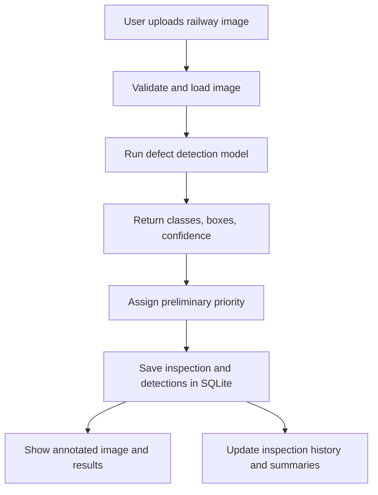

# Railway Track Health Intelligence System

## Project Overview

**Project duration:** 2 weeks  
**Team size:** 6 members  
**Goal:** Build a working prototype that analyzes railway-track images, detects possible defects, assigns a preliminary priority category, stores inspection results, and displays them in a dashboard.

### Prototype workflow

1. User uploads a railway-track image.
2. The image is processed by a computer-vision model.
3. The model returns any detected defect classes, bounding boxes, and confidence scores.
4. A rule-based component assigns a **preliminary** low, medium, or high priority.
5. The inspection record is saved to a local SQLite database.
6. The dashboard displays the annotated image, detections, summary statistics, and inspection history.

> **Safety note:** This is an academic prototype, not a certified railway inspection system. Model confidence is not the same as defect severity. Priority rules must be documented as illustrative and must not be used to make real-world railway safety decisions.

---

## 1. Team Responsibilities

Each member owns a component, but all members are expected to help with integration and testing.

### Member 1 — AI Model and Defect Detection

**Main objective:** Make the model detect the selected railway-track defect categories on sample images.

Tasks:
- Find and run a suitable pretrained model.
- Select a dataset/model appropriate for the chosen defect categories.
- Build an inference function that accepts an image and returns detections.
- Return defect class, confidence score, and bounding-box coordinates when available.
- Save or return an annotated image for display.
- Test on multiple images, including examples where no defect is detected.
- Document model limitations and required model weights.

**Deliverables:**
- `detection/detector.py`
- Model weights or clear instructions for obtaining them
- Example predictions and annotated images
- Notes on the model and its limitations

**Handoff:** Provide a documented function/interface to Members 2, 5, and 6.

### Member 2 — Dataset, Image Processing, and Evaluation

**Main objective:** Ensure the team uses suitable data and evaluates model results honestly.

Tasks:
- Find and document a suitable railway defect dataset.
- Confirm what each label means and whether annotations are available.
- Organize train/validation/test data if model fine-tuning is feasible.
- Use OpenCV for necessary image loading, resizing, or preprocessing.
- Keep evaluation images separate from training data where applicable.
- Help Member 1 test and improve inference.
- Calculate appropriate metrics when ground-truth labels are available, such as precision, recall, and F1 score.
- Record false positives, false negatives, and difficult cases.

**Deliverables:**
- Dataset source and usage notes
- Organized sample/test images
- Evaluation summary and representative failure cases
- `dataset/README.md` or equivalent documentation

**Handoff:** Provide a small, reliable test set to the whole team. Do not commit large datasets to Git unless the team has agreed to do so.

### Member 3 — Database and Inspection Records

**Main objective:** Store and retrieve inspection results.

Tasks:
- Set up SQLite.
- Create a table for inspection records.
- Store image filename/reference, inspection date/time, detected class, confidence, preliminary priority, and any available bounding-box data.
- Implement functions to initialize the database, save records, and retrieve inspection history.
- Handle missing or invalid values safely.
- Test that saved records remain available after restarting the app.

**Deliverables:**
- `database/db.py`
- Database schema documentation
- Working save/retrieve functions

**Handoff:** Agree on function names and record fields with Members 4 and 6 before integration.

### Member 4 — User Interface and Dashboard

**Main objective:** Make the prototype easy to demonstrate and use.

Tasks:
- Build a Streamlit interface.
- Add image upload and a button to run detection.
- Display the original and annotated images.
- Show detected classes, confidence scores, and preliminary priority labels.
- Display inspection history from SQLite.
- Add simple summary statistics, such as the number of inspections and detections by category.
- Handle unsupported files and model/database errors with clear messages.

**Deliverables:**
- `app.py` and/or `dashboard/components.py`
- Working upload/results/history screens
- Simple instructions for launching the app

**Handoff:** Coordinate with Members 1, 3, and 5 so the dashboard uses their actual functions and data.

### Member 5 — Severity Rules and Maintenance Prioritization

**Main objective:** Add a transparent, explainable preliminary priority category.

Tasks:
- Agree with the team on the defect categories the prototype supports.
- Design simple, documented rules for low, medium, and high priority.
- Use only information the prototype actually has, such as defect class and any validated measurements.
- Do not treat the model confidence score alone as a measure of severity.
- Provide a function that accepts a detection and returns a priority category plus a short explanation.
- Test the rules on example detections.
- Document that the rules are illustrative and require expert validation before any real-world use.

**Deliverables:**
- `prioritization/severity.py`
- Written explanation of the rules and their limitations
- Example inputs and outputs

**Handoff:** Agree on input/output fields with Members 1 and 3.

### Member 6 — Integration, Testing, and Project Coordination

**Main objective:** Keep the project organized and ensure all components work together.

Tasks:
- Create and maintain the shared GitHub repository and folder structure.
- Add a `.gitignore` and shared dependency list.
- Agree on interfaces and data formats with all members early.
- Ensure each member can run and test their component independently.
- Integrate detection, prioritization, storage, and dashboard.
- Run end-to-end tests and track bugs.
- Keep a known-good sample image and backup annotated outputs for the demo.
- Maintain the README and prepare the final demo checklist.

**Deliverables:**
- Repository structure and integration instructions
- `requirements.txt`
- `tests/test_workflow.py` or an equivalent test checklist
- Working end-to-end demo
- Final README and demo plan

**Important:** Member 6 coordinates integration but is not the only person responsible for it. Each component owner must help debug their own component.

---

## 2. Suggested Repository Structure

```text
railway-track-health/
├── app.py
├── requirements.txt
├── README.md
├── .gitignore
├── config.py
├── detection/
│   ├── __init__.py
│   └── detector.py
├── dataset/
│   └── README.md
├── database/
│   ├── __init__.py
│   └── db.py
├── dashboard/
│   └── components.py
├── prioritization/
│   ├── __init__.py
│   └── severity.py
├── tests/
│   └── test_workflow.py
├── uploads/
└── outputs/
```

The exact structure may change during implementation. Keep imports consistent and update this README if the structure changes.

### Git and file hygiene

- Use feature branches or small pull requests when possible.
- Commit source code and documentation.
- Avoid committing large datasets, model weights, private files, or generated outputs unless agreed.
- Add environment folders, database files, caches, and large data files to `.gitignore` as appropriate.
- Never commit passwords, API keys, or other secrets.

---

## 3. Shared Data Contract

Agree on a common format before separate components are built. The following is an illustrative single-detection record; values are examples, not model output.

```python
{
    "image_name": "track_001.jpg",
    "defect_type": "crack",
    "confidence": 0.91,
    "severity": "medium",
    "inspection_date": "2026-10-25"
}
```

Recommended fields:

| Field | Meaning |
|---|---|
| `inspection_id` | Unique ID for the inspection record |
| `image_name` | Original uploaded image filename or stored reference |
| `defect_type` | Model-predicted class |
| `confidence` | Model confidence, if available |
| `bbox` | Bounding-box coordinates, if available |
| `severity` | Preliminary priority category from documented rules |
| `priority_reason` | Short explanation of the assigned category |
| `inspection_date` | Date/time the inspection was run |

An image may contain zero, one, or multiple detections. The team should decide whether to store one row per inspection with detections in a related table, or one row per detection. For a small prototype, one row per detection plus a shared inspection ID is a practical approach.

### Suggested interfaces

- **Member 1:** `detect_image(image) -> detections, annotated_image`
- **Member 3:** `init_db()`, `save_inspection(record)`, `get_inspection_history()`
- **Member 5:** `assign_priority(detection) -> priority, reason`
- **Member 4:** calls the above functions from the UI
- **Member 6:** verifies the integrated flow and documents how to run it

These are suggested interface names; the team may change them, but changes should be communicated to everyone.

---

## 4. End-to-End Workflow



### Expected behavior

1. Validate the uploaded file and show a useful error if it cannot be read.
2. Run inference and display the results.
3. If there are no detections, show “No defects detected by the model” rather than implying the track is safe.
4. Assign priority only using documented rules and available evidence.
5. Save the inspection and its detections.
6. Show the saved record in the dashboard history.
7. If any step fails, show an error and avoid saving misleading or incomplete records.

---

## 5. Two-Week Schedule

### Days 1–2 — Setup and first working components

**Everyone**
- Install Python and agree on the Python version.
- Clone the repository and verify the environment.
- Review the shared data format and interfaces.

**Member 1:** Run the model on at least one sample image.  
**Member 2:** Select and document the dataset and test images.  
**Member 3:** Create the SQLite database and basic schema.  
**Member 4:** Build the initial Streamlit page and image upload.  
**Member 5:** Draft the priority rules and their limitations.  
**Member 6:** Set up repository structure, `.gitignore`, and dependency instructions.

**Milestone:** Every component has a basic starting version.

### Days 3–5 — Independent components

- Member 1: return detections in the agreed format and produce annotated images.
- Member 2: prepare test cases and begin evaluating predictions.
- Member 3: finish save/retrieve functions and test persistence.
- Member 4: show uploads and a placeholder results layout.
- Member 5: implement priority assignment and explanations.
- Member 6: test each component independently and resolve interface mismatches.

**Milestone:** Components work separately, and the team agrees on the final handoff format.

### Days 6–8 — Integration

- Connect the UI to the detector.
- Pass detections to the prioritization function.
- Save inspection results to SQLite.
- Show annotated images, results, and inspection history.
- Test the entire flow on one machine.
- Fix the most important integration bugs.

**Milestone:** One complete end-to-end prototype works by Day 8.

### Days 9–11 — Testing and improvement

- Test on images not used during development.
- Record false positives, false negatives, and limitations.
- Calculate suitable metrics if reliable labels are available.
- Improve UI clarity and error handling.
- Check that the database persists across restarts.
- Confirm that empty detection results are handled correctly.

**Milestone:** The prototype has been tested and its performance is documented honestly.

### Days 12–14 — Freeze, document, and present

- Stop adding major features.
- Fix critical bugs only.
- Complete setup instructions and documentation.
- Prepare an architecture diagram and presentation.
- Rehearse the demo from a clean launch.
- Keep sample images and annotated outputs as a fallback.

**Milestone:** The project can be launched and demonstrated reliably.

---

## 6. Daily Team Routine

Have a short check-in every day. Each member reports:

1. **Completed:** What did I finish since the last check-in?
2. **Next:** What will I finish today?
3. **Blocked:** What is preventing progress?

Update a GitHub Project board or issue list with these statuses:

- `To do`
- `In progress`
- `Blocked`
- `In review`
- `Done`

If someone is blocked for more than a day, notify the team and simplify the feature rather than delaying integration.

---

## 7. Testing Checklist

### Detection
- [ ] The model loads successfully.
- [ ] A valid image produces a result.
- [ ] Bounding boxes and confidence values are displayed when supported.
- [ ] An image with no predicted detections is handled correctly.
- [ ] The team has tested images not used to develop the model.

### Data and prioritization
- [ ] Priority rules are documented and explainable.
- [ ] Confidence is not incorrectly treated as severity.
- [ ] Invalid or missing fields are handled safely.
- [ ] Inspection records can be saved and retrieved.
- [ ] Multiple detections from one image are handled consistently.

### Dashboard and integration
- [ ] Image upload works.
- [ ] Annotated output and detection details appear.
- [ ] Inspection history is displayed.
- [ ] Errors are shown clearly.
- [ ] The app launches using the documented steps.
- [ ] The complete workflow has been tested on the demo machine.

### Presentation
- [ ] The team can explain the architecture and each component.
- [ ] Evaluation results and limitations are documented.
- [ ] A backup demo image/output is ready.
- [ ] No feature is presented as production-ready railway safety certification.

---

## 8. Definition of Done

The prototype is ready to present when a team member can launch the app, upload a sample railway image, see model predictions, view a preliminary priority category, save the inspection, and find it in the history dashboard.

**Priority order:** working end-to-end flow first, reliable testing second, visual polish third, advanced features last.

## 9. Optional Features — Only If the Core Prototype Is Stable

Consider these only after the main workflow works:

- Video input
- Exporting inspection reports to CSV
- Filtering history by defect type or priority
- Comparing repeat inspections of the same identified track segment
- More advanced severity estimation
- Location mapping, if trustworthy location data is available

Do not add these at the expense of the core demo.

---

## 10. Meeting Notes and Decisions

Use this section to keep team decisions in one place.

- **Team members and names:** Add names for Members 1–6.
- **Chosen dataset and source:** Add link and usage/licensing notes.
- **Chosen model and version:** Record the exact model.
- **Supported defect categories:** List the categories the prototype can detect.
- **Python version:** Record the version used by the team.
- **How to run the app:** Add the final commands after setup is tested.
- **Known limitations:** List model, dataset, and prioritization limitations.

